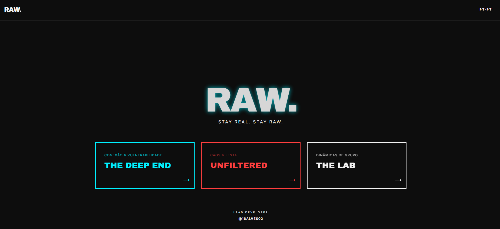
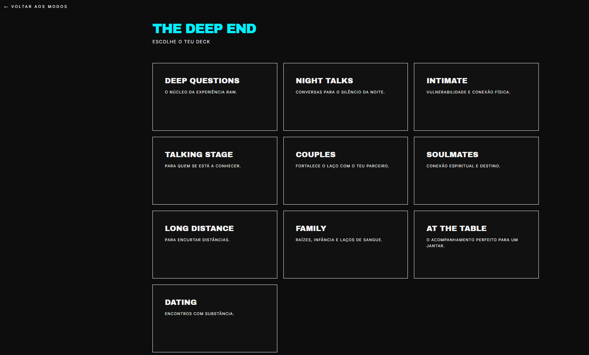
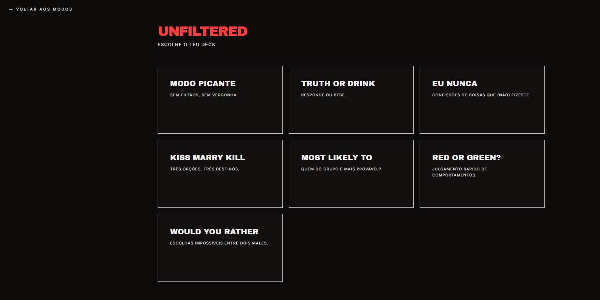
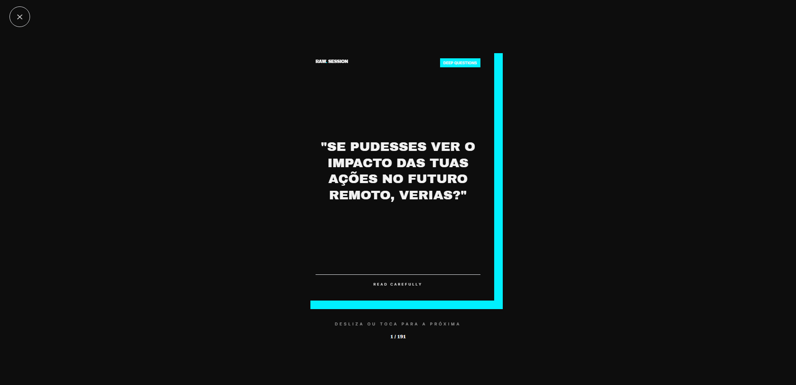
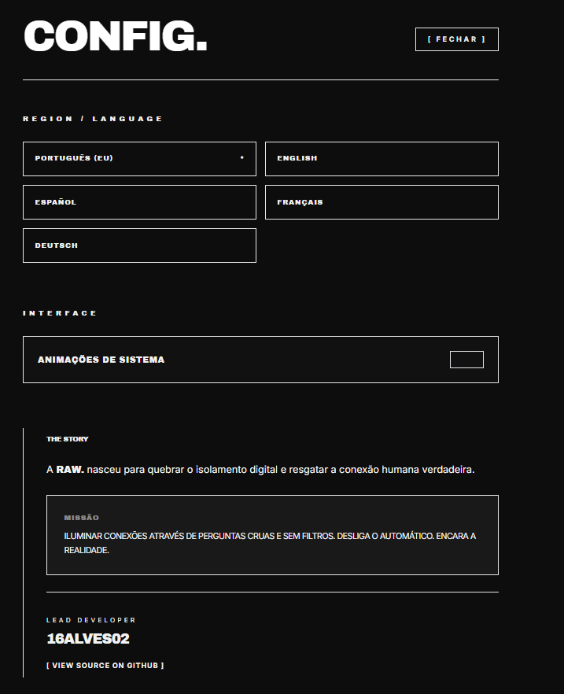

# ⚡ RAW.

[](https://react.dev/)
[](https://developer.mozilla.org/en-US/docs/Web/JavaScript)
[](https://tailwindcss.com/)
[](https://motion.dev/)
[](https://lucide.dev/)
[](https://postcss.org/)
[](https://create-react-app.dev/)
[](LICENSE)

> **Real Conversations. No Filters.**

## 🚀 Project Description

**RAW.** is an interactive social conversation experience designed around questions, games, movement and real-world interaction. Instead of another passive screen, the interface becomes a tool for conversations between people.

The application is organised into three modes:

| Mode | Purpose |
| --- | --- |
| 🔵 **THE DEEP END** | Deeper conversations, vulnerability and connection |
| 🔴 **UNFILTERED** | Social games, chaotic questions and group interaction |
| ⚪ **THE LAB** | Experimental games based on deduction, restrictions and unexpected answers |

**[Open the live experience](https://raw-app-bice.vercel.app)**

## Screenshots

### Home



### The Deep End



### Unfiltered



### The Lab


### Game card



### Settings



### THE DEEP END

Conversation decks cover a range of contexts, including Deep Questions, Night Talks, Intimate, Talking Stage, Couples, Soulmates, Long Distance, Family, At the Table and Dating. Deck content is stored in separate JSON files, keeping the content independent from the main interface.

### UNFILTERED

Fast-paced social games include Spicy, Truth or Drink, Never Have I Ever, Kiss, Marry, Kill, Who Is Most Likely, Red or Green? and Would You Rather. Decks share a common card-based interaction flow.

### THE LAB

Experimental mechanics include:

- **The Impostor:** players receive a group word and an impostor word, creating a deduction game.
- **Forbidden Words:** players explain a target concept without using a set of forbidden words.
- **Wrong Answers Only:** players are encouraged to give deliberately incorrect answers.

### Interaction and settings

The active card experience supports tap and horizontal swipe navigation, animated transitions, progress indication and haptic feedback where supported. Framer Motion handles card movement and transitions.

Settings include language selection, animation controls, a project story section and a link to the source repository. Available language options are Portuguese (EU), English, Spanish, French and German. Settings are persisted locally using `localStorage`.

## 🛠️ Tech Stack & Hooks

### Visual tech stack

| Technology | Role |
| --- | --- |
| React 18 | Component-based interface and UI state |
| JavaScript | Application logic |
| Tailwind CSS 3 | Utility-first styling and responsive layouts |
| Framer Motion | Animated transitions and draggable cards |
| Lucide React | Interface icons |
| Create React App | Development server and production build |
| PostCSS and Autoprefixer | CSS processing |
| Browser localStorage | Local settings persistence |
| Web Haptics API | Haptic feedback where the browser and device support it |

### React hooks identified in the source

- `useState`: tracks the current view, selected game mode, active deck, question list, current card and settings.
- `useEffect`: persists settings to `localStorage` when they change.

The application uses reusable components for the layout, header, footer and game cards, with game content separated into JSON data files.

## 🏗️ Project Structure

```text
src/
├── components/
│   ├── Card.js
│   ├── Footer.js
│   ├── Header.js
│   └── Layout.js
├── data/
│   └── modes/
│       ├── deep-end/
│       ├── lab/
│       └── unfiltered/
├── pages/
│   ├── Game.js
│   ├── Home.js
│   └── Settings.js
├── styles/
│   └── globals.css
├── utils/
│   └── feedback.js
└── App.js
```

## 💻 How to Run

### Requirements

- Node.js
- npm

### 1. Clone the repository

```bash
git clone https://github.com/16alves02/raw-app.git
cd raw-app
```

### 2. Install dependencies

```bash
npm install
```

### 3. Start the development server

```bash
npm start
```

The development server prints the local URL in the terminal. Open that address in your browser.

### Other commands

```bash
npm run build
npm test
```

- `npm run build` creates an optimised production build.
- `npm test` runs the Create React App test runner.

## 🎨 Visual Identity

RAW. uses a bold, minimal visual system designed to keep attention on the cards and conversations.

| Element | Value |
| --- | --- |
| Background | Deep Onyx `#0D0D0D` |
| Main accent | Electric Cyan `#00F0FF` |
| Unfiltered accent | Vivid Red `#FF3E3E` |
| Text | Raw Bone `#F2F2F2` |

Strong typography, generous spacing, sharp borders and high contrast reinforce the project's identity.

## 🔮 Future Improvements

- Add unit and component tests for mode selection, settings persistence and deck navigation.
- Migrate the project from Create React App to Vite for a more modern build setup.
- Introduce TypeScript to make game modes, deck data and settings safer to maintain.
- Add accessibility checks for keyboard interaction, reduced-motion preferences and screen-reader announcements.
- Improve error handling for malformed or missing local settings.
- Review bundle size and lazy-load game content where it provides a measurable performance benefit.
- Expand localisation coverage and validate all translated content consistently.

## 🗓️ Project History

RAW. was developed as an experimental frontend project and later published and refined on GitHub.

- **2025:** project development period.
- **2026:** repository publication and continued refinement.
- **2026:** additional formatting improvements and documentation updates.

## 👤 Author

**Leonardo Alves - [@16alves02](https://github.com/16alves02)**

RAW. is part of the **16alves02** project portfolio.

> **Stay Real. Stay RAW.**

## 📜 License & Copyright

**Copyright (c) 2025-2026 Leonardo Alves (16alves02). All rights reserved.**

This project is **not open source**. The source code is published for viewing and educational reference, but it may not be copied, redistributed, modified for public or commercial use, sublicensed, sold, or presented as someone else's work without prior written permission.

See the [LICENSE](./LICENSE) file for the full terms.
